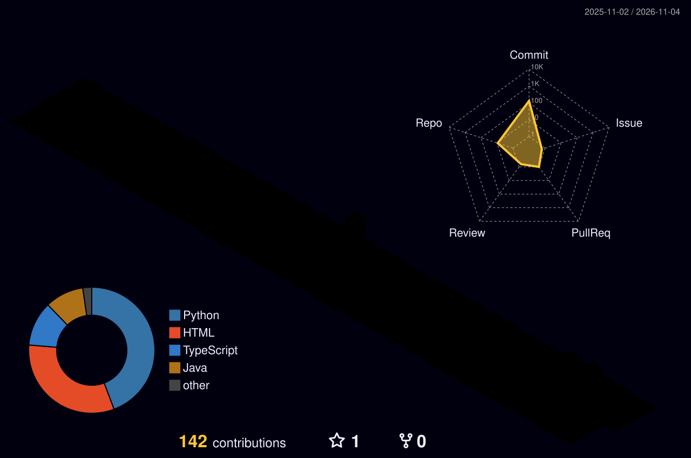

<div align="center">

<sub><code>SYS://PROFILE/ONLINE</code></sub>

# AoojunHappyman


<br />

<a href="https://github.com/AoojunHappyman"></a>


<br />

<a href="https://aoojunhappyman.github.io/My-Profile/">Portfolio ↗</a>

</div>

---

## ⚡ About Me

```text
$ whoami

name      = "Pattanachai Sawetbunchoed (Aoojun)"
focus     = data-driven web apps, dashboards & geospatial interfaces
education = Digital Science & Technology · Mahidol University
location  = Bangkok, Thailand
```

I build practical web projects that turn data into clearer tools and experiences. My repositories range from Bangkok mobility and geospatial dashboards to student wellbeing and personal finance apps.

## 🚀 Featured Projects

<table>
  <tbody>
    <tr>
      <td width="50%" valign="top">
        <strong><a href="https://github.com/AoojunHappyman/BKK-Geospatial-Intelligence">🗺️ BKK Geospatial Intelligence</a></strong><br />
        An interactive view of Bangkok across 50 districts, combining public datasets with maps, comparisons and data exploration.<br /><br />
        <sub>React · TypeScript · FastAPI · PostgreSQL/PostGIS · MapLibre</sub>
      </td>
      <td width="50%" valign="top">
        <strong><a href="https://github.com/AoojunHappyman/BKK-Traffic-Insight">🚦 Bangkok Traffic Insight</a></strong><br />
        A dashboard for exploring Bangkok traffic survey data by place, time and vehicle type, with map views and CSV/Excel export.<br /><br />
        <sub>Python · Flask · MySQL · JavaScript · Leaflet</sub><br />
        <sub><a href="https://bangkok-traffic-insight.onrender.com/">Open live demo ↗</a></sub>
      </td>
    </tr>
    <tr>
      <td width="50%" valign="top">
        <strong><a href="https://github.com/AoojunHappyman/Exmello">🫧 EXMELLO</a></strong><br />
        A student wellbeing app for exam season, with mood check-ins, focus sessions, breathing exercises and short breaks.<br /><br />
        <sub>TypeScript · Python</sub><br />
        <sub><a href="https://exmello.vercel.app/">Open live demo ↗</a></sub>
      </td>
      <td width="50%" valign="top">
        <strong><a href="https://github.com/AoojunHappyman/Expense-Tracker">💸 Expense Tracker</a></strong><br />
        A Thai-language personal finance app for recording income and expenses, exploring trends and reviewing spending charts.<br /><br />
        <sub>Python · JavaScript · HTML · CSS · Chart.js</sub><br />
        <sub><a href="https://expense-tracker-sg.onrender.com/">Open live demo ↗</a></sub>
      </td>
    </tr>
  </tbody>
</table>

## 🛠️ Tech Arsenal

**Languages**<br />


**Web, data & mapping**<br />


## 🌃 Contribution Skyline

<div align="center">
  
</div>

## 📊 GitHub Analytics

<div align="center">
  <a href="https://github.com/AoojunHappyman"></a>
  <a href="https://github.com/AoojunHappyman"></a>
  <br />
  
</div>

## ⚡ Contribution Activity

<div align="center">
  
</div>

## 🐍 Watch My Contributions Get Eaten

<div align="center">
  <picture>
    <source media="(prefers-color-scheme: dark)" srcset="./dist/github-snake-dark.svg" />
    <source media="(prefers-color-scheme: light)" srcset="./dist/github-snake.svg" />
    
  </picture>
</div>

---

<div align="center">

<sub><code>learn → build → refine → repeat</code></sub>

Thanks for visiting my corner of GitHub.

<sub><code>AoojunHappyman@github:~$ exit</code></sub>

</div>
